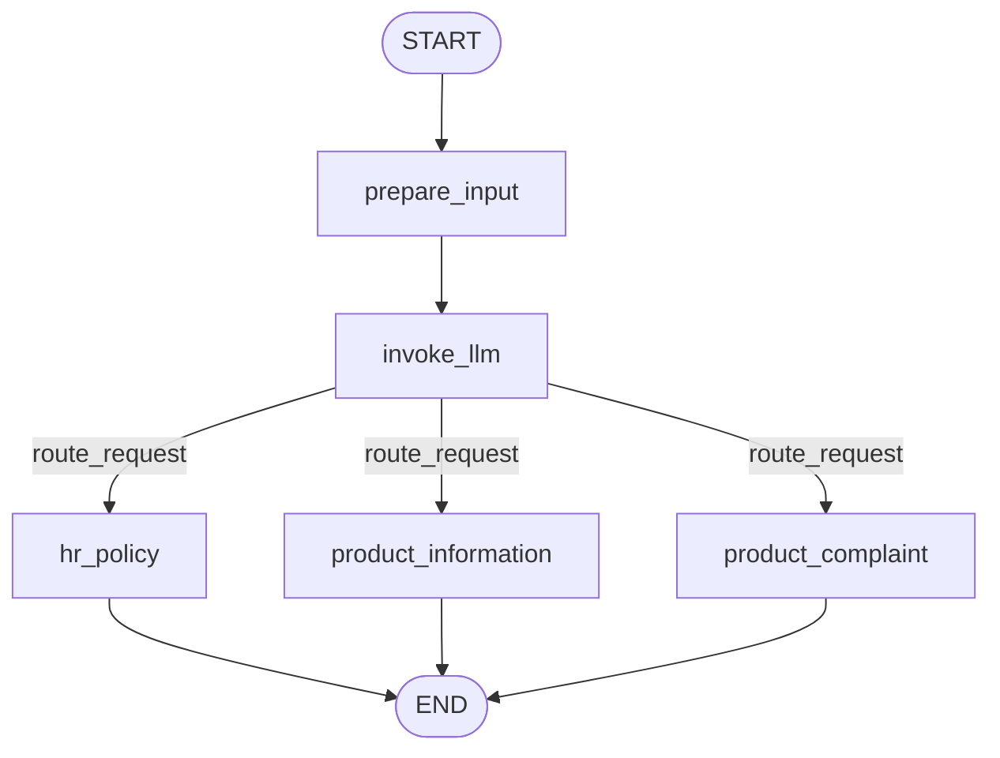

# `simple_chatbot` — Architecture & Execution Sequence

A minimal but complete **LangGraph** application. It takes a customer-support
message, uses one LLM call to **classify** it into a category *and* draft a
reply, then **routes** to a category-specific node that emits the final answer.

- **Entry point:** [`runner.py`](runner.py) — `python runner.py`
- **Model:** `us.anthropic.claude-sonnet-4-5-20250929-v1:0` on Bedrock (`us-east-1`, profile `develop-admin`)
- **Categories:** `hr_policy`, `product_information`, `product_complaint`

---

## 1. File-by-file: what each component does

Listed in **dependency order** (a file only depends on files above it). This is
also roughly the order Python imports them when you launch `runner.py`.

### 1. [`packages_file.py`](packages_file.py)
Pure re-export module. Imports every third-party symbol the project needs
(`ChatBedrockConverse`, `StateGraph`, `START`, `END`, `add_messages`,
`TypedDict`, message classes, `BaseModel`, `Field`, typing helpers) so the rest
of the codebase can do `from packages_file import X` and the external dependency
surface lives in one place. No logic.

### 2. [`prompts.py`](prompts.py)
Holds `SYSTEM_PROMPT` — the instruction text that tells the LLM to classify the
latest user message into exactly one of the three categories and to return a
category, a short reason, and a helpful response. Imported by `llm_file.py`.

### 3. [`input_output_format.py`](input_output_format.py)
The data contracts:
| Symbol | Purpose |
|--------|---------|
| `Category` | `Literal["hr_policy", "product_information", "product_complaint"]` — the single source of truth for category names. |
| `ChatInput` | Pydantic model wrapping one raw user string; `min_length=1` rejects empty input. |
| `RoutingDecision` | Pydantic model the LLM is **forced** to produce: `category` + `reason` + `response`. |
| `ChatOutput` | Pydantic model for the final printed result: `category` + `response`. |
| `take_user_input()` | Reads one line from stdin, strips it, returns a `ChatInput`. |

### 4. [`state_file.py`](state_file.py)
Defines `ChatState`, the `TypedDict` (with `total=False`) that LangGraph threads
through every node. Each node returns only the keys it produces and LangGraph
merges them:
| Key | Written by | Read by |
|-----|-----------|---------|
| `raw_input` | `runner.py` (`app.invoke`) | `prepare_input` |
| `messages` | `prepare_input`, `invoke_llm`, category nodes | `invoke_llm`, `runner.py` |
| `decision` | `invoke_llm` | `route_request`, `runner.py` |
| `decision_reason` | `invoke_llm` | (logging only) |
| `prepared_response` | `invoke_llm` | the category node that runs |

`messages` is `Annotated[list[AnyMessage], add_messages]` — the `add_messages`
reducer makes node returns **append** to history instead of overwriting it.

### 5. [`llm_file.py`](llm_file.py)
- Builds `llm` (`ChatBedrockConverse`, temp 0.1, 1000 max tokens).
- `routing_llm = llm.with_structured_output(RoutingDecision)` — every call now
  returns a validated `RoutingDecision` object rather than free text.
- **`invoke_llm(state)` node:** prepends `SystemMessage(SYSTEM_PROMPT)` to the
  running `state["messages"]`, calls `routing_llm`, and returns
  `{"decision", "decision_reason", "prepared_response"}`.

### 6. [`nodes_file.py`](nodes_file.py)
The nodes actually registered in the graph:
- **`prepare_input(state)`** — entry node. Wraps `state["raw_input"]` in a
  `HumanMessage` and returns `{"messages": [that message]}`.
- **`hr_policy(state)`**, **`product_information(state)`**,
  **`product_complaint(state)`** — terminal nodes, one per category. Each re-emits
  the LLM-drafted `state["prepared_response"]` as an `AIMessage`. This is the
  extension point where real category logic (HR lookups, catalogue queries,
  ticket creation) would go.

### 7. [`routers.py`](routers.py)
**`route_request(state) -> Category`** — the function attached to the conditional
edge. Returns `state["decision"]`; LangGraph maps that string to the next node.

### 8. [`graph_build.py`](graph_build.py)
Assembles and **compiles** the graph at import time:
```
builder = StateGraph(ChatState)
  nodes:  prepare_input, invoke_llm, hr_policy, product_information, product_complaint
  edges:  START -> prepare_input -> invoke_llm
  conditional edge: invoke_llm --(route_request)--> { hr_policy | product_information | product_complaint }
  edges:  each category node -> END
app = builder.compile()
```
Also `draw_graph()` — prints the Mermaid source and writes
`customer_support_graph.png` (needs network access).

### 9. [`runner.py`](runner.py)
Entry point. `run_chatbot()` is a REPL loop:
1. `take_user_input()`
2. break on `exit`
3. `app.invoke({"raw_input": ..., "messages": history})`
4. persist `history = result["messages"]`
5. build and print `ChatOutput(category=result["decision"], response=last message)`

`draw_graph()` is called only if you uncomment it in `__main__`.

### [`decision_nodes.py`](decision_nodes.py) — NOT USED
An earlier draft of the three category nodes. `graph_build.py` imports the
category nodes from `nodes_file.py`, so nothing in this file is wired into the
graph. Kept for reference.

### [`customer_support_graph.png`](customer_support_graph.png)
The rendered graph diagram — output of `draw_graph()`.

---

## 2. Execution sequence (runtime)

### Phase A — import & build (once, at process start)

```
python runner.py
  └─ import runner
       ├─ import packages_file          # third-party symbols
       ├─ import input_output_format    # Category, ChatInput, RoutingDecision, ChatOutput
       └─ import graph_build
            ├─ import state_file        # ChatState
            ├─ import nodes_file        # prepare_input + 3 category nodes
            ├─ import llm_file          # <-- builds ChatBedrockConverse + routing_llm HERE
            │    ├─ import input_output_format (cached)
            │    └─ import prompts      # SYSTEM_PROMPT
            ├─ import routers           # route_request
            └─ builder.add_node/add_edge/... ; app = builder.compile()   # graph ready
```
After imports finish, `run_chatbot()` starts.

### Phase B — per user turn (loop in `run_chatbot`)

```
take_user_input()                       input_output_format.py  -> ChatInput(message=...)
   │  (if message == "exit": print goodbye, break)
   ▼
app.invoke({ raw_input: message, messages: history })
   │
   ▼  START
prepare_input(state)                     nodes_file.py
   │   HumanMessage(raw_input)  ──►  messages += [HumanMessage]
   ▼
invoke_llm(state)                        llm_file.py
   │   [SystemMessage(SYSTEM_PROMPT), *messages]  ──►  routing_llm.invoke()
   │   returns RoutingDecision(category, reason, response)
   │   state += { decision, decision_reason, prepared_response }
   ▼
route_request(state)                     routers.py   (conditional edge)
   │   returns state["decision"]  ──►  selects ONE branch below
   ▼
┌───────────────┬───────────────────────┬───────────────────┐
│ hr_policy     │ product_information   │ product_complaint │   nodes_file.py
│   AIMessage(prepared_response)  ──►  messages += [AIMessage]
└───────────────┴───────────────────────┴───────────────────┘
   ▼
END  ──►  app.invoke returns final state
   │
   ▼
history = result["messages"]             runner.py   (thread history into next turn)
output  = ChatOutput(category=result["decision"],
                     response=result["messages"][-1].content)
print "Category: ..."  /  "Bot: ..."
   │
   └─ loop back to take_user_input()
```

### The graph



---

## 3. Key design points

- **One LLM call does two jobs.** `invoke_llm` both classifies *and* writes the
  answer (via the `RoutingDecision.response` field). The category nodes don't call
  the model again — they just surface `prepared_response`. Cheap, but the reply is
  not category-specialized yet.
- **Structured output = reliable routing.** `with_structured_output(RoutingDecision)`
  guarantees `decision` is always a valid `Category`, so the conditional edge
  cannot receive an unmapped string (short of a schema-violating model error).
- **`add_messages` reducer** is what makes the bot conversational: every node's
  `{"messages": [...]}` return is appended, and `runner.py` feeds the accumulated
  list back into the next `invoke`.
- **Extension point:** put real business logic (DB lookups, ticketing, RAG) inside
  the three terminal nodes in `nodes_file.py`; the routing scaffolding stays the
  same.
- **No checkpointer:** history lives only in the `runner.py` local variable, so it
  is lost when the process exits. Add a LangGraph checkpointer for persistence.
